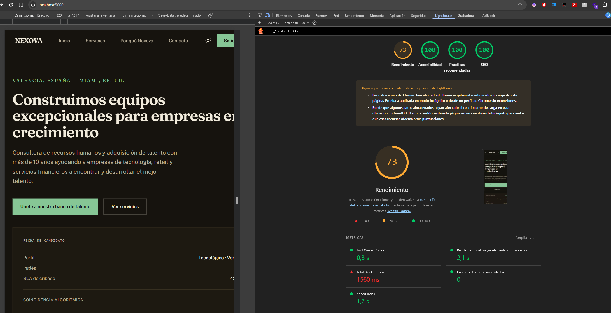
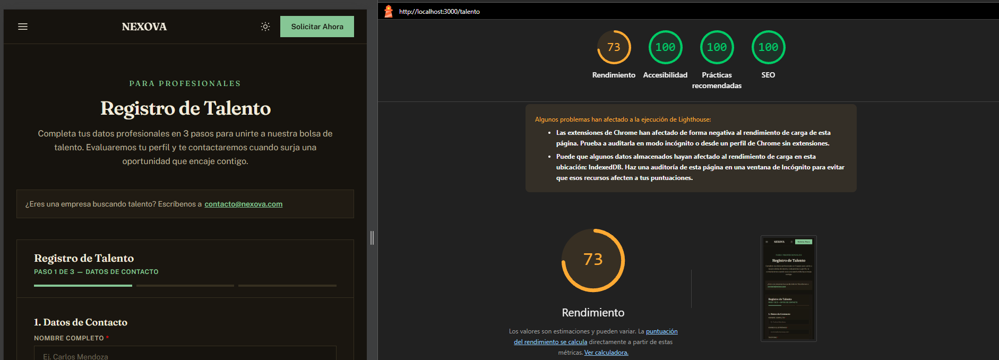

# Auditoría de rendimiento web

## Objetivo

Evaluar la experiencia de carga, interactividad y estabilidad visual de la web pública de Nexova, usando Core Web Vitals y evidencia de usuarios reales y del navegador.

## Alcance

- Web pública: `uis/website/` (Next.js), rutas `/` y `/talento`.
- Backoffice: `uis/backoffice/` (Next.js), página principal del pipeline y sus interacciones.
- Interacciones a revisar: menú móvil, cambio de tema, formulario de talento, filtros y navegación del pipeline.
- Métricas: LCP, INP y CLS.

## Umbrales de referencia

Google evalúa los Core Web Vitals en el percentil 75 de las visitas:

| Métrica | Buena | Necesita mejorar | Deficiente |
| --- | ---: | ---: | ---: |
| LCP — renderizado del contenido principal | ≤ 2,5 s | > 2,5 s y ≤ 4 s | > 4 s |
| INP — respuesta a las interacciones | ≤ 200 ms | > 200 ms y ≤ 500 ms | > 500 ms |
| CLS — estabilidad visual | ≤ 0,1 | > 0,1 y ≤ 0,25 | > 0,25 |

## Procedimiento

1. Consultar CrUX por URL y periodo disponible. Si no hay datos para la página, usar datos del origen y etiquetarlos explícitamente como alternativa.
2. Registrar una traza del navegador para cada ruta y escenario, anotando fecha, dispositivo, viewport, red, CPU y estado de caché.
3. Para LCP, identificar el elemento candidato y separar TTFB, demora de descubrimiento, carga del recurso y demora de renderizado.
4. Para INP, reproducir interacciones representativas y distinguir demora de entrada, procesamiento del callback y presentación del siguiente frame.
5. Para CLS, registrar el nodo que se desplaza, el elemento que inicia el cambio y el momento de la visita. No atribuir la causa al nodo desplazado sin comprobar la traza.
6. Priorizar solo problemas respaldados por datos de campo o trazas. No añadir precargas especulativas ni optimizaciones genéricas.
7. Tras cada corrección, repetir las mismas rutas, interacciones y condiciones de laboratorio. Comparar laboratorio con laboratorio y campo con campo; no presentar una medición de laboratorio como si fuera el p75 de usuarios.
8. Esperar nuevas visitas de CrUX o RUM antes de afirmar que una corrección mejoró los resultados de campo.

## Escenarios mínimos

- Carga inicial de `/` en móvil y escritorio.
- Carga inicial de `/talento` en móvil y escritorio.
- Abrir y cerrar el menú móvil.
- Cambiar el tema.
- Avanzar y retroceder pasos del formulario, mostrar errores y completar el envío simulado.

## Registro de mediciones

Completar este registro al ejecutar las mediciones. Si una fuente no está disponible, indicar `Sin datos` y explicar por qué.

| Fecha | Ruta / escenario | Dispositivo y condiciones | Fuente | LCP p75 / lab | INP p75 / lab | CLS p75 / lab | Observaciones |
| --- | --- | --- | --- | --- | --- | --- | --- |
| 2026-10-19 | Web pública `/` (`localhost:3000`) | Build de producción según confirmación del usuario; vista responsive, 820 × 1217 | Captura de Lighthouse proporcionada por el usuario | Sin p75 / 2,1 s | Sin datos | Sin p75 / 0 | Rendimiento 73; TBT 1.560 ms. Advertencias de extensiones e IndexedDB. |
| 2026-10-19 | Backoffice inicial `/` (`localhost:3001`) | Desarrollo: iniciado con `npm run dev -- -p 3001`; viewport no legible | Primera captura de Lighthouse proporcionada por el usuario | Sin p75 / 1,2 s | Sin datos | Sin p75 / 0 | Rendimiento 72; TBT 1.930 ms; accesibilidad 94. Antecedente de desarrollo. |
| 2026-10-19 | Backoffice actual `/` (`localhost:3001`) | Producción: build completado y servidor iniciado con `npm run start -- -p 3001` | Nueva captura adjunta a la conversación | Sin datos / no visible | Sin datos | Sin datos / no visible | Rendimiento 72; accesibilidad 94; prácticas recomendadas 100; SEO 100. Advertencias de extensiones e IndexedDB. |
| 2026-10-19 | Web pública `/talento` (`localhost:3000/talento`) | Mismo servidor de la web pública; build de producción confirmado por el usuario; viewport no visible | [Captura del registro de talento](./imagen1TalentoAntes.png) | Sin datos / no visible | Sin datos | Sin datos / no visible | Rendimiento 73; accesibilidad 100; prácticas recomendadas 100; SEO 100. Advertencias de extensiones e IndexedDB. |

### Datos de la captura de la web pública

- Puntuaciones: rendimiento 73, accesibilidad 100, prácticas recomendadas 100 y SEO 100.
- Métricas de laboratorio: FCP 0,8 s y Speed Index 1,7 s.
- Diagnósticos: ejecución de JavaScript 2,1 s; trabajo del hilo principal 2,9 s; 1.967 KiB de JavaScript sin usar; 78 KiB de ahorro estimado al minificar; 13 KiB de JavaScript antiguo; 9 tareas largas y 4 marcas User Timing.
- Evidencia: [imagen1FrontEndAntes.png](./imagen1FrontEndAntes.png).

### Captura del registro de talento

- URL visible: `http://localhost:3000/talento`.
- Estado visible del formulario: paso 1 de 3, datos de contacto, en tema oscuro.
- Puntuaciones: rendimiento 73, accesibilidad 100, prácticas recomendadas 100 y SEO 100.
- Persisten las advertencias de extensiones de Chrome y datos almacenados en IndexedDB.
- La captura no muestra FCP, LCP, TBT, CLS, Speed Index ni INP. No reutilizar para esta ruta las métricas medidas en la portada `/`.
- Evidencia local: [imagen1TalentoAntes.png](./imagen1TalentoAntes.png).

### Datos de la primera captura del backoffice (desarrollo)

- Puntuaciones: rendimiento 72, accesibilidad 94, prácticas recomendadas 100 y SEO 100.
- Métricas de laboratorio: FCP 0,8 s, LCP 1,2 s, TBT 1.930 ms, CLS 0 y Speed Index 2,5 s.
- Evidencia histórica: `imagen1BackofficeAntes.png`, guardada en el commit `24fc46d`. El archivo ya no está en el directorio de trabajo; sus datos se conservan como antecedente de desarrollo.
- La captura no permite leer con seguridad el viewport ni muestra diagnósticos Lighthouse desplegados; no inferirlos.

### Captura actual del backoffice (producción)

- Recibida después de completar `npm run build` y arrancar `npm run start -- -p 3001`; se comprobó respuesta HTTP 200 en `localhost:3001`.
- Puntuaciones visibles: rendimiento 72, accesibilidad 94, prácticas recomendadas 100 y SEO 100.
- La nueva imagen está recortada antes de las métricas: no permite registrar FCP, LCP, TBT, CLS, Speed Index ni INP. Los valores de la captura de desarrollo no se trasladan a esta medición.
- Persisten las advertencias de extensiones de Chrome y datos de IndexedDB.
- Fuente: nueva imagen adjunta al chat; su archivo local aún no se ha localizado. El archivo recibido posteriormente contiene `/talento` y está registrado en esa ruta; no sirve como PNG del backoffice.

### Límites de estas capturas

- Las capturas son mediciones de laboratorio locales, no p75 de campo; ninguna aporta INP.
- Lighthouse advierte en las capturas que extensiones de Chrome y datos almacenados en IndexedDB pudieron afectar la carga. Mantener estas advertencias al comparar resultados y repetir la medición sin extensiones para obtener evidencia adicional.
- Distinguir el antecedente de desarrollo del backoffice de la captura actual en producción; no atribuir al código diferencias causadas por el modo de ejecución.

## Criterios de cierre

- Las mediciones de campo y laboratorio quedan identificadas por separado.
- Cada problema reportado tiene evidencia y atribución asociada.
- Las correcciones se verifican repitiendo el escenario y las condiciones originales.
- Las conclusiones no declaran una métrica aprobada o fallida cuando faltan datos.

