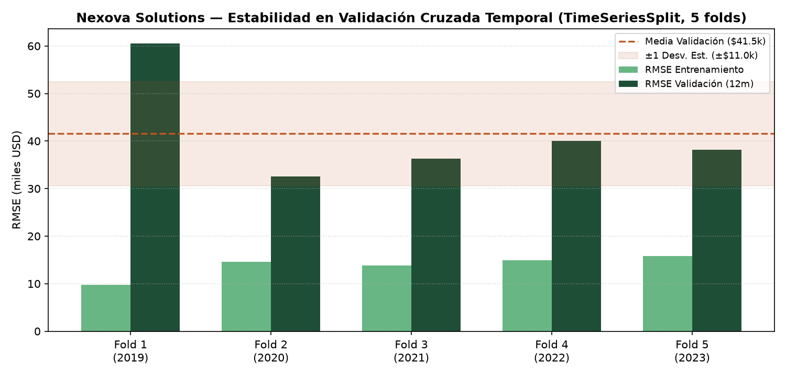
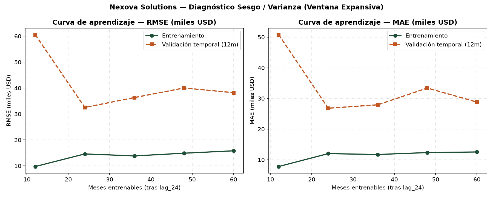

# Reporte Técnico de Evaluación — Modelo de Pronóstico de Ventas (Nexova Solutions)

**Modelo evaluado:** `RandomForestRegressor` (`n_estimators=300`, `max_depth=6`, `min_samples_leaf=2`, `random_state=42`) sobre `y_yoy = revenue_usd / lag_12 - 1` con reconstrucción recursiva.  
**Dataset:** `data/raw/nexova_sales.csv` (`business_line == "consolidated"`, 120 meses `2016-01` a `2025-12`).  
**Bloque evaluado en CV:** primeros 8 años (`2016-01` a `2023-12`, 96 meses; el hold-out `2024-01` a `2025-12` permanece intocado).

---

## 1. Veredicto Ejecutivo y Clasificación

- **Clasificación explícita:** **Overfitting** (sobreajuste moderado-alto).
- **Decisión para paso a staging:** **Aprobado con condición (aplicar acción correctiva antes de promover)**. El modelo base logra un error de validación medio aceptable en porcentaje (`~4.9%` del ingreso mensual), pero presenta una brecha amplia y persistente entre entrenamiento (`RMSE = $13,776.20`) y validación (`RMSE = $41,534.04`, ratio **3.01×**) y una desviación estándar elevada entre ventanas temporales (`± $11,005.43`, CV = `26.5%`).

---

## 2. Selección y Justificación de Métricas (MAE vs. RMSE)

| Conjunto | RMSE (USD) | MAE (USD) |
| --- | ---: | ---: |
| **Entrenamiento (media ± desv. est.)** | \$13,776.20 ± \$2,359.96 | \$11,281.55 ± \$1,974.97 |
| **Validación temporal (media ± desv. est.)** | \$41,534.04 ± \$11,005.43 | \$33,544.76 ± \$9,963.74 |

### ¿Cuál refleja mejor el costo de negocio de Nexova?

**RMSE refleja mejor el costo de negocio de Nexova** que MAE:

1. Según `briefing/sales-forecasting-briefing.md`, **Laura (CEO)**, **Javier (Operaciones)** y **Marcos (Ventas)** necesitan distinguir con confianza entre una caída estacional normal (agosto: `-15%` a `-25%` por vacaciones en España) o un repunte fiscal (enero–febrero: `+15%` a `+20%`) frente a una desviación anómala real que requiera reasignar presupuesto o capacidad en Valencia y Miami.
2. En ese contexto, **un error grande en un mes crítico** (por ejemplo, fallar por \$70,000 en agosto o enero) es mucho más costoso operativamente que dos errores pequeños de \$15,000 en meses estables (`±5%`). Al elevar los residuos al cuadrado, **RMSE penaliza desproporcionadamente los errores grandes** y se alinea directamente con el **MSE** exigido en el briefing.
3. **MAE** se reporta como complemento lineal para Finanzas, indicando el desvío promedio típico por mes (`$33,544.76`).

---

## 3. Validación Cruzada Temporal (`TimeSeriesSplit`, 5 folds)

La validación se ejecutó con `TimeSeriesSplit(n_splits=5, test_size=12)` **directamente sobre la serie cruda** (`2016-01` a `2023-12`) antes de calcular lags o estadísticas rodantes. Cada fold valida sobre 12 meses completos (incluyendo siempre agosto y enero–febrero) de forma estrictamente recursiva, sin fuga de información futura.

| Fold | Ventana Train (cruda / entrenable) | Ventana Val (12m) | Train RMSE | Val RMSE | Train MAE | Val MAE | Val $R^2$ |
| :---: | --- | --- | ---: | ---: | ---: | ---: | ---: |
| **1** | `2016-01..2018-12` (36 / 12) | `2019-01..2019-12` | \$9,746.52 | \$60,583.36 | \$7,794.19 | \$50,797.86 | 0.4764 |
| **2** | `2016-01..2019-12` (48 / 24) | `2020-01..2020-12` | \$14,605.75 | \$32,528.64 | \$12,004.27 | \$26,805.03 | 0.8526 |
| **3** | `2016-01..2020-12` (60 / 36) | `2021-01..2021-12` | \$13,839.64 | \$36,317.82 | \$11,719.18 | \$27,922.70 | 0.7846 |
| **4** | `2016-01..2021-12` (72 / 48) | `2022-01..2022-12` | \$14,882.11 | \$40,026.17 | \$12,347.33 | \$33,383.92 | 0.7277 |
| **5** | `2016-01..2022-12` (84 / 60) | `2023-01..2023-12` | \$15,806.98 | \$38,214.21 | \$12,542.76 | \$28,814.27 | 0.8350 |
| **Media ± DE** | — | — | **\$13,776.20 ± \$2,359.96** | **\$41,534.04 ± \$11,005.43** | **\$11,281.55 ± \$1,974.97** | **\$33,544.76 ± \$9,963.74** | **0.74 ± 0.15** |

---

## 4. Curva de Aprendizaje y Diagnóstico Sesgo / Varianza

| Meses crudos | Meses entrenables (tras `lag_24`) | Fin Train | Periodo Val (12m) | Train RMSE | Val RMSE | Train MAE | Val MAE |
| ---: | ---: | --- | --- | ---: | ---: | ---: | ---: |
| 36 | 12 | `2018-12-01` | `2019-01..2019-12` | \$9,746.52 | \$60,583.36 | \$7,794.19 | \$50,797.86 |
| 48 | 24 | `2019-12-01` | `2020-01..2020-12` | \$14,605.75 | \$32,528.64 | \$12,004.27 | \$26,805.03 |
| 60 | 36 | `2020-12-01` | `2021-01..2021-12` | \$13,839.64 | \$36,317.82 | \$11,719.18 | \$27,922.70 |
| 72 | 48 | `2021-12-01` | `2022-01..2022-12` | \$14,882.11 | \$40,026.17 | \$12,347.33 | \$33,383.92 |
| 84 | 60 | `2022-12-01` | `2023-01..2023-12` | \$15,806.98 | \$38,214.21 | \$12,542.76 | \$28,814.27 |

**Lectura de la curva:**
- Con solo 12 meses entrenables (`2018`), el modelo memoriza (`Train RMSE = $9,746.52`) y falla al generalizar a `2019` (`Val RMSE = $60,583.36`).
- A partir de 24–60 meses entrenables, el error de entrenamiento se estabiliza alrededor de `~$14k–$16k`, mientras el error de validación oscila entre `$32.5k` y `$40.0k`: **la brecha (~2.4× a 3.0×) no se cierra**, confirmando **overfitting**.

---

## 5. Acción Correctiva Específica (Causa Raíz y Evidencia)

**Causa raíz identificada:** aunque el target (`y_yoy`) es estacionario, la matriz de entrada actual incluye tres features en **escala nominal USD creciente** (`rolling_mean_3`, `rolling_std_3`, `rolling_mean_12`) que aumentan ~4% cada año. En un `RandomForestRegressor` con `max_depth=6` y `min_samples_leaf=2`, los árboles usan esos umbrales nominales para identificar años específicos del pasado en lugar de aprender únicamente la dinámica estacional y de ciclo (`1%` vs `7%`).

Se evaluaron alternativas concretas sobre el mismo `TimeSeriesSplit(n_splits=5, test_size=12)`:

| Candidato | Train RMSE (media) | Val RMSE (media ± DE) | Val MAE (media ± DE) | Ratio Val/Train |
| --- | ---: | ---: | ---: | ---: |
| `baseline_actual (depth=6, leaf=2, 13 features)` | \$13,776.20 | \$41,534.04 ± \$11,005.43 | \$33,544.76 ± \$9,963.74 | 3.01× |
| `regularizacion_moderada (depth=4, leaf=4, sqrt, 13 features)` | \$22,866.15 | \$43,713.62 ± \$7,156.29 | \$36,677.25 ± \$6,065.88 | 1.91× |
| `regularizacion_fuerte (depth=3, leaf=5, sqrt, 13 features)` | \$25,000.95 | \$43,561.93 ± \$6,552.24 | \$36,675.40 ± \$5,154.08 | 1.74× |
| **`poda_features_nivel + reg (depth=4, leaf=3, 10 features estacionarias)`** | **\$17,677.83** | **\$40,273.22 ± \$11,671.17** | **\$33,053.80 ± \$9,953.95** | **2.28×** |
| `alta_complejidad_control (depth=None, leaf=1, 13 features)` | \$11,254.47 | \$42,904.27 ± \$10,618.38 | \$34,527.96 ± \$9,727.60 | 3.81× |

### Recomendación concreta para staging
1. **Eliminar las 3 features de nivel nominal no estacionarias** (`rolling_mean_3`, `rolling_std_3`, `rolling_mean_12`) y conservar únicamente las 10 features estacionarias de ratios YoY/MoM y calendario.
2. **Regularizar la profundidad del bosque** a `max_depth=4` y `min_samples_leaf=3`, reduciendo el error medio de validación a **\$40,273.22** (RMSE) / **\$33,053.80** (MAE) y bajando la brecha train/val de **3.01× a 2.28×**.
