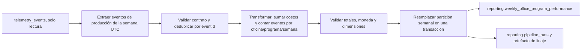

# Diseño del pipeline de desempeño de negocio

## 1. Estado actual

La API almacena eventos en la tabla append-only `telemetry_events`. Sus columnas
son `event_id`, `timestamp`, `session_id`, `user_id`, `event_type`,
`schema_version`, `request_id` y `tags` (JSONB). Las propiedades de negocio se
conservan en `tags` mediante una lista permitida. La clave primaria actual es
`event_id`.

El reporte técnico existente, `GET /telemetry/report`, utiliza
`services/telemetry/analysis.py` para presentar volumen, errores, latencia y
fallos de login a Ingeniería. Responde una pregunta distinta y permanece fuera
del alcance de este diseño. El nuevo pipeline leerá `telemetry_events` y
escribirá sus resultados exclusivamente en el esquema `reporting`.

### Brecha de negocio

El reporte técnico no compara inversión en materiales, entregas ni señales de
escasez o variación de costos entre las oficinas y los programas. La pregunta
sin responder es cómo se desempeña cada oficina y programa en costo de material,
kits entregados, escasez y variaciones de costo durante la semana.

## 2. Propósito, audiencia y métricas

El pipeline produce el **Reporte Semanal de Desempeño por Oficina y Programa**
para Laura (CEO) y Elena (Gerente de L&D), con datos frescos cada lunes por la
mañana. Su propósito es consolidar, por oficina y programa, el costo de material,
los kits entregados, la frecuencia de escasez y la frecuencia de variación de
costo. Lo alimentan `inbound_order_created`, `outbound_order_created`,
`stock_threshold_triggered` y `kit_cost_variance_detected`.

| KPI | Fuente | Cálculo por semana |
| --- | --- | --- |
| Costo de material por oficina/programa | `inbound_order_created` | Suma de `total_cost_minor` y conversión de unidades menores a unidades monetarias (÷ 100); conservar la moneda local. |
| Kits entregados | `outbound_order_created` | Conteo de eventos de entrega. No sumar `quantity`: el contrato del reporte define este KPI como conteo de eventos. |
| Frecuencia de escasez | `stock_threshold_triggered` | Conteo de eventos. |
| Frecuencia de variación de costo | `kit_cost_variance_detected` | Conteo de eventos. |

`direct_stock_edit_rejected` sigue siendo un evento obligatorio de telemetría,
pero no alimenta ninguno de los cuatro KPI de este reporte y queda fuera de la
extracción de la v1.

## 3. Grano y contrato de datos

Cada fila representa una combinación única de oficina, programa y semana ISO:

- `office`: `valencia` o `miami`.
- `programme_id`: slug estable del programa.
- `week_start`: lunes de la semana ISO en UTC.
- `currency`: `EUR` para Valencia y `USD` para Miami; no se convierten ni suman
  monedas distintas.
- Semana de negocio: intervalo UTC semiabierto `[week_start, week_start + 7
  días)`.

Solo se agregan eventos de `environment=production`, con dimensiones de oficina
y programa válidas y campos exigidos por el contrato del evento. No se inventan
programas, categorías, costos ni monedas para completar datos faltantes. Los
eventos que no se puedan enriquecer se contabilizan como rechazados o pendientes
de reconciliación, no como ceros.

La extracción consulta desde `telemetry_events` las columnas
`event_id`, `timestamp`, `event_type`, `request_id` y `tags`. El payload de
negocio ya normalizado se encuentra en `tags`, no en una columna `properties`.
Para el costo de una entrada se usará `total_cost_minor` (céntimos), no el costo
unitario ni una tarifa mensual del directorio de proveedores.

La tabla de destino conserva el nombre y las columnas definidos por el
briefing:

```sql
create table reporting.weekly_office_program_performance (
  id uuid primary key default gen_random_uuid(),
  office text not null,
  programme_id text not null,
  week_start date not null,
  total_material_cost numeric not null default 0,
  kits_delivered_count integer not null default 0,
  shortage_events_count integer not null default 0,
  cost_variance_events_count integer not null default 0,
  currency text not null,
  computed_at timestamptz not null default now(),
  unique (office, programme_id, week_start)
);
```

## 4. Flujo de datos



### Etapas

1. **Extracción:** cada lunes a las 06:00 UTC, leer la semana ISO completa
   anterior. La consulta usa un rango UTC semiabierto, limita los cuatro tipos
   de evento que alimentan los KPI y filtra `environment=production` en SQL.
   Las filas se leen en lotes ordenados por `(timestamp, event_id)`.
2. **Validación y deduplicación:** comprobar el contrato específico del evento,
   dimensiones, moneda y costo. Deduplicar por `eventId`; mantener conteos de
   válidos, duplicados, rechazados y pendientes de reconciliación.
3. **Transformación:** convertir `total_cost_minor` a decimal de moneda mayor,
   sumar costo de entradas y contar cada evento de salida, escasez o variación
   de costo. Agrupar por `office`, `programme_id` y `week_start`.
4. **Validación de resultados:** verificar que no haya monedas mezcladas en una
   fila, que los importes no sean negativos y que los conteos concuerden con los
   eventos de entrada aceptados. Registrar las filas y totales de control antes
   de cargar.
5. **Carga:** dentro de una sola transacción de base de datos, reemplazar la
   partición semanal afectada con el resultado completo y hacer commit. Si
   cualquier paso de carga falla, hacer rollback de toda la sustitución.
6. **Auditoría:** guardar estado, parámetros, conteos, checkpoints, errores y
   manifiesto de linaje. Marcar la corrida `Completed` solo después del commit.

## 5. Idempotencia, reintentos y eventos tardíos

### Deduplicación en la ingesta

La clave del envelope es `eventId` (`event_id` en almacenamiento). La
deduplicación primaria corresponde a la ingesta, antes de que el evento entre en
`telemetry_events`; el pipeline vuelve a proteger sus agregados con el mismo ID
para no contar reentregas dos veces. Dos recepciones del mismo evento con
distintos tiempos de llegada son un solo hecho de negocio: se conserva el
contenido original y el instante de recepción se registra aparte.

La operación deseada es un upsert/no-op por `eventId`: si el ID y el payload
canónico coinciden, responder éxito idempotente; si el ID coincide pero el
payload difiere, rechazarlo como conflicto y dejar evidencia. `requestId`,
`timestamp` y `received_at` no sustituyen a `eventId` como clave. El almacén
actual ya tiene `event_id` como clave primaria, pero `insert_telemetry_events`
ejecuta un `INSERT` normal: una repetición puede causar un error de integridad y
`POST /telemetry/events` responde `503`. Este comportamiento actual debe
corregirse en una fase de implementación de ingesta, con sus pruebas; este
diseño no modifica el endpoint.

### Reintento tras carga parcial

Una nueva corrida calcula desde cero el resultado completo para las semanas
afectadas; nunca incrementa las métricas existentes. La carga elimina y vuelve
a insertar la partición, o asigna todos los valores finales mediante upsert,
dentro de la misma transacción. El unique key
`(office, programme_id, week_start)` protege la granularidad, mientras que el
reemplazo completo elimina también filas obsoletas si desaparece una
combinación en una corrección. Un timeout antes del commit deja la partición
anterior intacta; el reintento obtiene el mismo resultado que una corrida limpia
si la fuente deduplicada y la ventana son las mismas.

### Eventos tardíos

La semana se determina por el `timestamp` del evento, no por su hora de
recepción. La ingesta conserva `received_at` UTC y `ingestion_id` como metadatos
de recepción fuera del envelope; se usan para detectar eventos llegados tras el
watermark de una corrida. Cuando un evento tardío pertenece a una semana ya
publicada, marcar esa partición como invalidada, registrar el `run_id` que la
detectó y recalcular la semana completa desde la fuente deduplicada. La
sustitución atómica corrige el resultado sin duplicar conteos. El log mantiene
la corrida original, la corrida correctiva, la causa, la ventana, los IDs
afectados y el estado de ambas.

La detección de llegadas tardías requiere que el sistema de ingesta persista
`received_at`/`ingestion_id` asociados a `eventId`. La tabla actual solo conserva
el `timestamp` del hecho; el detalle de esta limitación y su solución debe
resolverse antes de implementar reconciliación completa.

## 6. Observabilidad, trazabilidad y crecimiento

### Registro de ejecución

Guardar el control de corridas en `reporting.pipeline_runs`, con al menos:

| Campo | Tipo | Por qué se registra |
| --- | --- | --- |
| `run_id` | UUID | Identidad única para correlacionar Prefect, logs, checkpoints y correcciones. |
| `pipeline_name` | text | Distinguir este flujo de futuros pipelines. |
| `trigger` | text (`schedule`/`manual`/`backfill`) | Saber por qué comenzó la corrida. |
| `status` | text | Estado `Running`, `Completed` o `Failed`. |
| `started_at`, `finished_at` | timestamptz | Medir duración y detectar corridas colgadas. |
| `requested_by` | text nullable | Auditar quién pidió una ejecución manual, sin guardar secretos. |
| `week_start`, `source_window_end` | date/timestamptz | Reconstruir el período exacto procesado. |
| `phase`, `checkpoint` | text | Saber dónde retomar tras un fallo. |
| `source_watermark` | timestamptz nullable | Separar datos ya vistos de llegadas tardías. |
| `events_read`, `events_valid`, `events_duplicate`, `events_rejected` | integer | Cuantificar entrada, calidad y deduplicación. |
| `rows_written` | integer | Comparar los agregados preparados con los confirmados. |
| `input_digest`, `output_digest` | text | Detectar cambios de entrada y reproducir la transformación. |
| `prefect_flow_run_id` | text | Navegar desde el control de negocio hasta Prefect. |
| `error_code`, `error_summary` | text nullable | Diagnóstico seguro; el resumen no contiene secretos ni payloads sensibles. |

Los valores de inicio, checkpoints, conteos y resultado deben sobrevivir al
proceso que ejecuta Prefect; una variable en memoria no es un checkpoint durable.

### Silencio frente a actividad cero

Un reporte con conteos cero solo significa actividad cero si la ingesta confirma
que estuvo operativa. Registrar un heartbeat del colector, el último evento
recibido, recibidos/guardados/rechazados por intervalo y el estado del último
pipeline. Alertar si falta el heartbeat, el job programado no inicia o el
intervalo esperado queda sin señal de captura. Comparar los eventos con sesiones
activas y oficinas que reportan antes de concluir que la actividad de negocio
cayó.

### Linaje y análisis de ráfagas

Cada artefacto de corrida conserva `run_id`, `requestId`, `eventId`, tipo de
evento, timestamp de negocio, `received_at`, dimensiones de salida, ventana,
watermark y hashes de entrada/salida. El manifiesto duradero relaciona los
eventos que contribuyeron a cada fila agregada con su clave
`(office, programme_id, week_start)`. Así puede comprobarse si una subida seguida
de una caída refleja hechos de negocio o si una corrida procesó dos ventanas a la
vez.

Para diagnosticar variaciones de volumen, comparar eventos únicos por tipo con
sesiones activas, oficinas que reportaron, recibidos/guardados/rechazados,
latencia de recepción y eventos tardíos. Interpretar los conteos considerando el
día de la semana y la cadencia real; un lunes alto frente a un domingo bajo no
prueba crecimiento ni pérdida por sí solo.

## 7. Recuperabilidad, transmisión y concurrencia

### Fallo de base de datos y checkpoints

El registro persistente guarda las fases `extract`, `validate`, `transform`,
`load` y `verify`, la ventana de origen, el watermark y el `run_id`. Tras
transformar, escribir el resultado preparado y su digest en un staging durable
asociado a `run_id`; no depender del DataFrame en memoria. Si la base se cae
durante la carga, el estado queda `Failed` con checkpoint `transform` y error
transitorio. El siguiente intento reusa el staging validado o, si no está
disponible, extrae y transforma de nuevo la misma ventana. Solo la sustitución
transaccional confirma la publicación.

### Buffer en el frontend

El navegador puede mantener una cola acotada y temporal para no perder eventos
durante una desconexión breve. Cada evento conserva su `eventId` original,
`timestamp` y payload; al recuperar conexión se transmiten en lotes pequeños con
reintentos con backoff y jitter. La cola debe tener límite de tamaño y edad,
limpieza tras confirmación y cuidado para no persistir información personal o
comercial sensible en `localStorage`. Una cola agotada o vencida se cuenta y
registra, no se oculta. El cliente mejora la entrega; el servidor sigue siendo
responsable de deduplicar.

### Reintentos de `POST /telemetry/events`

El cliente reintenta timeout, desconexión y respuestas transitorias `429`/`5xx`,
respetando `Retry-After` cuando exista. Un `200` indica que el lote se procesó;
un evento ya almacenado también debe confirmar éxito idempotente, no provocar un
reintento infinito. Errores permanentes de validación no se reintentan sin
cambiar el payload. La misma clave `eventId` se reutiliza en cada intento.

El contrato actual devuelve `received`, `stored` y `rejected`; el diseño de
ingesta idempotente debe definir explícitamente el resultado por evento ya
almacenado y mantener compatibilidad con esos conteos.

### Corridas concurrentes

Antes de procesar una ventana, obtener un lock durable con clave
`(pipeline_name, week_start)`. La creación de corrida tiene `run_id` único; el
lock/lease registra propietario, expiración y heartbeat. Si cron y una solicitud
manual se solapan, la segunda devuelve el estado de la corrida en curso en vez
de cargar otra vez. Al expirar una lease sin heartbeat, una nueva ejecución
puede tomar el lock y reanudar desde el checkpoint persistido. Las corridas de
semanas diferentes no se bloquean entre sí.

## 8. Diseño con Prefect

**Flow principal:** `weekly_office_program_performance_flow`, programado para
los lunes a las 06:00 UTC. Parámetros: `week_start` opcional, `trigger` y
`requested_by` opcional. Si no se indica semana, calcula la última semana ISO
completa.

| Task Prefect | Responsabilidad |
| --- | --- |
| `extract_telemetry_events` | Leer por lotes la ventana y los tipos necesarios en modo solo lectura. |
| `validate_and_deduplicate_events` | Aplicar contratos, allowlists, filtros de producción y deduplicación por `eventId`. |
| `aggregate_weekly_performance` | Convertir importes y calcular métricas al grano oficina/programa/semana. |
| `validate_weekly_aggregates` | Validar dimensiones, monedas, importes, conteos y digests. |
| `stage_weekly_aggregates` | Persistir salida validada asociada a `run_id` para recuperación. |
| `replace_reporting_partition` | Reemplazar la semana afectada en una sola transacción. |
| `finalize_pipeline_run` | Registrar checkpoint final, conteos, hashes, duración y estado. |

Las tareas de extracción, escritura de staging, carga y cierre admiten reintento
limitado para fallos transitorios con backoff. Errores de contrato o datos
inválidos fallan la corrida o producen rechazos contabilizados según la política
del evento; nunca se silencian. Los estados relevantes son `Running`,
`Completed` y `Failed`.

Los bloques de Prefect contienen el conector de Supabase de solo lectura para
`telemetry_events`, el conector de escritura acotado a `reporting`, la
configuración de staging y los parámetros de despliegue. Secretos y claves se
guardan en bloques/secretos del entorno de Prefect; nunca en el repositorio, en
los parámetros visibles de una corrida ni en los logs.

## 9. Endpoints del módulo `services/reporting/`

Los endpoints son una capa de transporte y autorización. No contienen Pandas,
deduplicación, agregaciones ni otras reglas ETL; importan funciones del paquete
`data/pipelines/`.

Por tratar costos y datos internos, los tres endpoints requieren autenticación
de administrador en la v1. El rol de negocio de Laura y Elena no existe aún en
el modelo de usuarios; cuando se incorpore, se podrá conceder lectura del
reporte sin permiso para disparar corridas. El disparo manual permanece
reservado a administradores.

| Endpoint | Uso | Función/flow de `data/pipelines/` |
| --- | --- | --- |
| `GET /reporting/pipeline-runs/latest` | Consultar estado, fases, tiempos y conteos de la corrida más reciente. | `get_latest_pipeline_run()` lee el registro de corridas. |
| `POST /reporting/pipeline-runs` | Solicitar una corrida manual opcionalmente para `week_start`; devuelve `run_id` y estado aceptado/en curso. | `submit_weekly_office_program_performance_flow(...)` envía el flow de Prefect. |
| `GET /reporting/weekly-office-program-performance` | Consultar el reporte; acepta `week_start` y, si se omite, usa la semana completa calculada más reciente. | `get_weekly_office_program_performance(week_start)` consulta la tabla de destino. |

El GET del reporte devuelve `week_start` y `entries` con `office`,
`programme_id`, los cuatro campos KPI y `currency`, tal como define el contrato
del briefing. No lee ni escribe `telemetry_events` desde el handler.

## 10. Alcance y prerrequisitos de implementación

Este entregable es de diseño. No implementa código de orquestación, tablas,
migraciones, endpoints ni cambios de telemetría. Antes de implementar el
pipeline se deben resolver y probar estos contratos upstream:

1. Hacer idempotente el almacenamiento por `eventId`, con no-op para payload
   repetido y conflicto observable para payload distinto.
2. Conservar en el almacenamiento el campo obligatorio `total_cost_minor`.
   El esquema de eventos lo define, pero el allowlist actual de
   `services/api/telemetry_storage.py` no lo incluye, así que hoy se perdería al
   persistir `tags`.
3. Persistir `received_at` e `ingestion_id` asociados con `eventId` para
   detectar y auditar eventos tardíos. El envelope permanece inmutable; esos
   datos son metadatos de recepción.
4. Definir y validar el catálogo/control efectivo de `programme_id`, `office`,
   `currency` y las dimensiones necesarias para excluir eventos incompletos sin
   inventar datos.

La v1 no convierte monedas, no cambia el reporte técnico, no escribe en
`telemetry_events`, no añade KPIs distintos de los cuatro definidos ni
incorpora eventos fuera del conjunto necesario.
